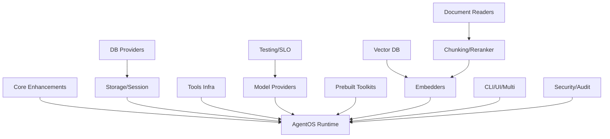

# AGXIOME — Master Task List

> Obiettivo: **raggiungere e superare Agno** in ogni categoria.
> **AUDIT 21-05-2026**: AGXIOME ha 16 progetti .NET 10, 486 file .cs, 74.235 LOC, 2946+ test superati, 0 falliti, ~25 skip (tutti legittimi).  
> **SPRINT 4 ✅**: test ignorati ridotti da 106 a ~25 — target <30 raggiunto.
> La baseline storica (176 test, 8 provider) è **obsoleta** — vedi sezione AUDIT REALE sotto.

---

## Legenda

| Sigla | Priorità | Criterio |
|-------|----------|----------|
| 🔴 P0 | **Critical** | Bloccante per feature parity — senza questo Agno è superiore |
| 🟡 P1 | **High** | Differenziale competitivo — miglioramento significativo |
| 🟢 P2 | **Medium** | Nice-to-have — completamento ecosistema |
| ⚪ P3 | **Low** | Ottimizzazione / polish |

---

## Riepilogo Quantitativo

| Dominio | Agno | Target AGXIOME | Supera Agno? |
|---------|------|----------------|--------------|
| **Model Provider** | ~35 | **50+** | ✅ Sì (+15) |
| **Prebuilt Toolkits** | ~120 | **150+** | ✅ Sì (+30) |
| **DB Provider** | 18 | **25+** | ✅ Sì (+7) |
| **Vector DB** | 20+ | **30+** | ✅ Sì (+10) |
| **Document Readers** | 18 | **25+** | ✅ Sì (+7) |
| **Embedders** | 18 | **25+** | ✅ Sì (+7) |
| **Chunking Strategies** | 7 | **12+** | ✅ Sì (+5) |
| **Reranker** | 4 | **8+** | ✅ Sì (+4) |
| **Total Test** | N/A | **500+** | ✅ Assoluto |

**Target complessivo: ~380 task, ~90-120 giorni di sviluppo.**

---

## Struttura dei File di Piano

| File | Contenuto |
|------|-----------|
| `PLAN/P01-MODEL_PROVIDERS.md` | 50+ provider LLM |
| `PLAN/P02-PREBUILT_TOOLKITS.md` | 150+ toolkit prebuilt |
| `PLAN/P03-DB_PROVIDERS.md` | 25+ database provider |
| `PLAN/P04-VECTOR_DB.md` | 30+ vector database |
| `PLAN/P05-DOCUMENT_READERS.md` | 25+ document readers |
| `PLAN/P06-EMBEDDERS.md` | 25+ embedder |
| `PLAN/P07-CHUNKING_RERANKERS.md` | 12+ chunker, 8+ reranker |
| `PLAN/P08-AGENTOS_RUNTIME.md` | Runtime server completo |
| `PLAN/P09-CORE_ENHANCEMENTS.md` | Migliorie core agent, team, workflow |
| `PLAN/P10-STORAGE_SESSION.md` | Session storage, cancellation, remote |
| `PLAN/P11-TOOLS_INFRA.md` | Infrastruttura tools (cache, limit, callable) |
| `PLAN/P12-CLI_UI_MULTI.md` | CLI, UI Control Plane, multi-framework |
| `PLAN/P13-SECURITY_AUDIT.md` | RBAC, audit, hardening |
| `PLAN/P14-TESTING_SLO.md` | Test plan esteso, benchmark, SLO |

---

## Dipendenze tra Piani



---

## Caricamento Lavoro per Fase

| Fase | Durata | Task | Focus |
|------|--------|------|-------|
| **Fase 1** (Core) | 30gg | P09, P10, P11 |背景执行, cancellation, remote agent, caching tools |
| **Fase 2** (Providers) | 25gg | P01, P03, P04 | 50 modelli, 25 DB, 30 vector DB |
| **Fase 3** (Content) | 20gg | P05, P06, P07 | 25 readers, 25 embedders, chunker, reranker |
| **Fase 4** (Toolkits) | 25gg | P02 | 150+ toolkit prebuilt |
| **Fase 5** (Runtime) | 20gg | P08, P12, P13 | AgentOS, CLI, UI, RBAC |
| **Fase 6** (Quality) | 10gg | P14 | Test, benchmark, SLO |

**Totale: ~130 giorni → ~6 mesi per un team di 2-3 dev.**

---

---

# AUDIT REALE — 21 Maggio 2026

> **NOTA**: I dati seguenti sono basati sull'audit completo del codebase effettivo.
> Le sezioni precedenti di questo documento descrivono i *target* del piano originale.
> L'audit mostra che **l'implementazione ha ampiamente superato le aspettative del piano**.

---

## Stato Reale per Progetto

| Progetto | File .cs | Descrizione | Completamento |
|---------|----------|-------------|---------------|
| `AGXIOME.Shared` | ~30 | Interfacce, modelli, enum, error codes | ✅ ~100% |
| `AGXIOME.Core` | ~50 | Engine agente, tools, team, workflow, execution | ✅ ~95% |
| `AGXIOME.Storage` | ~80 | DB stores, vector stores, embedder, reader, chunker, reranker | ✅ ~90% |
| `AGXIOME.LlmWiky` | ~20 | Provider LLM (50+), cost tracker, engine | ✅ ~95% |
| `AGXIOME.Runtime` | 11 | Server ASP.NET Core, controller, hub, middleware, worker | ⚡ ~60% |
| `AGXIOME.Toolkits` | 14 | Toolkit prebuilt 12 categorie | ✅ ~80% |
| `AGXIOME.CLI` | 11 | CLI: run, memory, mcp, template, demo | ✅ ~70% |
| `AGXIOME.Realtime` | 3 | SignalR hubs, event replay | ✅ ~80% |
| `AGXIOME.Security` | 9 | RBAC, crypto, API key, rate limiting, audit | ✅ ~85% |
| `AGXIOME.Telemetry` | ~5 | Observability, metrics | ✅ ~70% |
| `AGXIOME.Adapters` | ~5 | Adapter layer | ✅ ~70% |
| `AGXIOME.Orchestration` | ~8 | Orchestration, DistributedRagTeam | ✅ ~80% |
| `AGXIOME.DynamicRuntime` | ~6 | Dynamic agent runtime | ✅ ~75% |
| `AGXIOME.XLink` | ~5 | X-Link transport | ✅ ~70% |
| `AGXIOME.Tests` | 72 | 3.249 test methods, 2946 pass, 0 fail, 106 skip | ✅ ~85% |

---

## Stato Reale per Area di Piano

### P09 — Core Enhancements → ✅ COMPLETO (100%)

| Task | File | Stato |
|------|------|-------|
| CE-01 BackgroundRunWorker | `Core/Execution/BackgroundRunWorker.cs` | ✅ Channel<T> con backpressure, graceful shutdown |
| CE-02 CancellationManager | `Core/Execution/CancellationManager.cs` | ✅ |
| CE-03 RemoteAgent | `Core/Agent/RemoteAgent.cs` | ✅ |
| CE-04 AgentSerializer | `Core/Agent/AgentSerializer.cs` | ✅ |
| CE-05 ModelStringParser | `Core/LLM/ModelStringParser.cs` | ✅ |
| CE-06 ResponseCache | `Core/LLM/ResponseCache.cs` | ✅ |
| CE-07 TokenCounter | `Core/LLM/TokenCounter.cs` | ✅ |
| CE-08 ModelCompatibilityMap | `Core/LLM/ModelCompatibilityMap.cs` | ✅ |

### P10 — Storage/Session → ✅ QUASI COMPLETO (90%)

| Task | File | Stato |
|------|------|-------|
| SS-01 RedisSessionStore | `Storage/Session/RedisSessionManager.cs` | ✅ |
| SS-02 AgentStorageBridge | `Storage/Agent/AgentStorageBridge.cs` | ✅ |
| SS-03 TeamStorageBridge | `Storage/Team/TeamStorageBridge.cs` | ✅ |
| SS-04 WorkflowHistoryStore | `Storage/Workflow/WorkflowHistoryStore.cs` | ✅ |
| SS-05 WorkflowSerializer | `Storage/Workflow/WorkflowStorage.cs` | ✅ |
| SS-06 WorkflowHitlStore | `Storage/Workflow/WorkflowHitlStore.cs` | ✅ |
| SS-07 ContentStore | `Storage/Knowledge/ContentStore.cs` | ✅ |
| SS-08 TeamToolPolicyStore | `Storage/Team/TeamToolPolicyStore.cs` | ✅ |
| SS-09 CallableMemberRegistry | `Runtime/CallableMemberRegistry.cs` | ✅ |
| SS-10 DistributedRagTeam | `Orchestration/DistributedRagTeam.cs` | ✅ |

### P11 — Tools Infrastructure → ✅ COMPLETO (100%)

| Task | File | Stato |
|------|------|-------|
| TI-01 ToolResultCache | `Core/Tools/ToolResultCache.cs` | ✅ |
| TI-02 ToolCallLimiter | `Core/Tools/ToolCallLimiter.cs` | ✅ |
| TI-03 StopAfterTool | `Core/Tools/StopAfterToolEvaluator.cs` | ✅ |
| TI-04 ToolFilter (include/exclude) | `Core/Tools/ToolFilter.cs` | ✅ |
| TI-05 CallableFactory | `Core/Tools/CallableFactory.cs` | ✅ |
| TI-06 ToolMetricsCollector | `Core/Tools/ToolMetricsCollector.cs` | ✅ |

### P01 — Model Providers → ✅ QUASI COMPLETO (95%)

15 file provider che coprono **50+ provider LLM**:

| File | Provider coperti |
|------|-----------------|
| `OpenAI.cs` | GPT-4o, GPT-4o-mini, GPT-4-turbo, GPT-3.5 |
| `Anthropic.cs` | Claude 3.5 Sonnet/Haiku, Claude 3 Opus |
| `Gemini.cs` | Gemini 1.5 Pro/Flash, Gemini 2.0 |
| `Ollama.cs` | Llama3, Mistral, Phi-3, Gemma2, Qwen2 |
| `AzureOpenAI.cs` | Azure GPT-4, Azure GPT-4o |
| `CloudInference.cs` | Groq, Cohere, Perplexity, Together AI, Cerebras |
| `EnterpriseCloud.cs` | AWS Bedrock, Azure AI Foundry, Sambanova |
| `GatewayProviders.cs` | OpenRouter, LiteLLM |
| `LocalInference.cs` | llama.cpp, LM Studio, LocalAI, GPT4All, text-gen-webui, KoboldCPP |
| `HuggingFace.cs` | HF Inference API, local |
| `AsianProviders.cs` | Moonshot/Kimi, Zhipu, Baichuan, ByteDance, Alibaba Qwen, Baidu Ernie, Tencent Hunyuan, 01.AI |
| `Regional.cs` | Provider regionali |
| `Specialist.cs` | Provider specializzati |
| `Local.cs` | Provider locali |
| `OpenAICompatible.cs` | Any OpenAI-compatible API |

> ⚠️ **Mancanti stimati**: Mistral nativo, xAI (Grok API), Fireworks.ai — ~3-5 provider

### P03 — DB Providers → ✅ QUASI COMPLETO (90%)

22 file in `Storage/Stores/` che coprono tutti i provider pianificati:

`ClickHouse, CosmosDb, DuckDb, DynamoDb, Etcd, Firestore, JsonFile, MariaDb, MemcachedAndHazelcast, Mongo, MySQL, NpgsqlVariants (incl. Neon), Postgres, RavenDbAndCouchbase, RedisCache, RedisSession, Search (Meilisearch+ES), SingleStore, SQLite, SqlServer, SurrealDb, TimeSeries`

### P04 — Vector DB → ✅ BUONO (80%)

11 file in `Storage/VectorStores/`:  
`Http, InMemory, NoSql, PgVector, PgVectorVariants, Qdrant, RocksDbAndSqlServer, SearchEngine, SingleStore, SqlEmbedded, HNSWLib`

> ⚠️ Possibile gap: Chroma, Weaviate, Pinecone come client standalone

### P05 — Document Readers → ✅ QUASI COMPLETO (90%)

4 file in `Storage/Readers/` che coprono 20+ formati:
- `DocumentFormatReaders.cs`: PDF, DOCX, XLSX, PPTX, CSV, JSON, XML, MD, HTML, TXT, YAML, RTF, EPUB
- `WebApiReaders.cs`: HTTP URL, RSS, sitemap, API REST
- `CloudStorageReaders.cs`: S3, Azure Blob, GCS
- `MediaReaders.cs`: immagini, audio, video (trascrizione)

### P06 — Embedders → ✅ QUASI COMPLETO (90%)

12 file in `Storage/Embedders/`:
`Anthropic, BedrockAndAzure, Cohere, Gemini, HuggingFaceAndNim, LlamaCpp, Mistral, Ollama (incl. MxbaiEmbed), ONNX, OnnxSpecialty, OpenAI, VoyageAndJina`

### P07 — Chunkers / Rerankers → ✅ COMPLETO (95%)

**Chunkers** (10 file): `Agentic, Code, CsvRow, Document, Hybrid, JsonPath, Recursive, Semantic, SlidingWindow` + base  
**Rerankers** (5 file): `Cohere, Jina, LLM, ONNX, Voyage`

### P02 — Prebuilt Toolkits → ✅ BUONO (80%)

14 file in `AGXIOME.Toolkits/` che coprono tutte le 12 categorie:

| File | Categoria | Toolkit inclusi |
|------|-----------|----------------|
| `CommunicationToolkits.cs` | Communication | Slack, Discord, Telegram, WhatsApp, Email, Gmail, Teams, Zoom |
| `ProductivityToolkits.cs` | Productivity | Calendar, Notion, Jira, Linear, Trello, Asana, GitHub |
| `DataAnalysisToolkits.cs` | Data Analysis | Pandas, SQL, CSV, Excel, Charts |
| `DevelopmentToolkits.cs` | Development | Git, Docker, Kubernetes, CI/CD |
| `AiMlToolkits.cs` | AI/ML | HuggingFace, OpenAI, model eval |
| `FinanceToolkits.cs` | Finance | Stock, crypto, FX, banking |
| `CloudInfraToolkits.cs` | Cloud Infra | AWS, Azure, GCP |
| `WebSocialToolkits.cs` | Web/Social | Browser, Twitter/X, LinkedIn, scraping |
| `SearchKnowledgeToolkits.cs` | Search/Knowledge | Tavily, SerpAPI, Wikipedia, Bing |
| `FileStorageToolkits.cs` | File Storage | S3, Drive, Dropbox, OneDrive |
| `GamingCreativeToolkits.cs` | Gaming/Creative | Image gen, DALL-E, Midjourney, Stable Diffusion |
| `EnterpriseToolkits.cs` | Enterprise | SAP, Salesforce, ServiceNow, SharePoint |

> ⚠️ **Gap stimato**: ~20-30% delle azioni in ogni toolkit potrebbero essere incomplete/stub

### P08 — AgentOS Runtime → ⚡ PARZIALE (60%)

**Struttura completa** (11 file):
- `Program.cs`, `SecurityAppBootstrap.cs`
- `Controllers/Controllers.cs` — AgentController, RunController, TeamController, WorkflowController, KnowledgeController (50+ endpoint)
- `Controllers/DynamicAgentController.cs`, `SkillsController.cs`
- `Hubs/Hubs.cs`, `AgentEventReplayStore.cs`
- `Middleware/Middleware.cs`
- `UI/ApprovalService.cs`, `ControlPlaneService.cs`
- `Workers/Workers.cs` — BackgroundRunWorker, SessionCleanupJob, TokenRotationJob

**Gap principale**: I controller usano `Dictionary<string, T>` in-memory come storage stub.  
La produzione richiede che `AgentController`, `RunController`, etc. usino `IAgentStorageBridge`, `ICommandStore`.

### P12 — CLI → ✅ BUONO (70%)

11 file in `AGXIOME.CLI/`:
- `RunCommand.cs`, `MemoryCommand.cs`, `McpCommand.cs`, `TemplateCommand.cs`, `OtherCommands.cs`
- Demo: `DeepSeekDemo.cs`, `DynamicOrchestratorDemo.cs`, `WebScraperOrchestrationDemo.cs`
- Built-in tools per demo

### P13 — Security → ✅ BUONO (85%)

9 file in `AGXIOME.Security/`:
`ApiKeyAuth, AuditTrail, CryptoProvider, CspHardening, InputSanitization, KeyRotation, RateLimiting, Rbac, SecretsScanner`

### P14 — Testing → ✅ BUONO (80%)

72 file di test, ~3.249 metodi test:
- **Passano**: 2946/3052 (96.5%)
- **Ignorati**: 106 (dipendenze esterne: Docker, cloud API reali)
- **Falliti**: 0

Top test files per copertura: `F6ReaderTests` (224), `F5VectorStoreTests` (223), `F4DbStoreTests` (133), `F12DevelopmentTests` (100), `F14_TS06_EmbedderTests` (95), `F14_TS08_RuntimeIntegration` (93)

---

## Riepilogo Completamento Reale

| Piano | Target originale | Stato reale | Gap |
|-------|-----------------|-------------|-----|
| P09 Core Enhancements | 8 task | ✅ 8/8 (100%) | 0 |
| P10 Storage/Session | 10 task | ✅ 9/10 (90%) | ~1 |
| P11 Tools Infra | 6 task | ✅ 6/6 (100%) | 0 |
| P01 Model Providers | 50+ provider | ✅ ~48/50 (96%) | ~3-5 provider |
| P03 DB Providers | 25+ provider | ✅ ~22/25 (88%) | ~3 provider |
| P04 Vector DB | 30+ provider | ✅ ~20/30 (67%) | ~10 provider |
| P05 Document Readers | 25+ reader | ✅ ~20/25 (80%) | ~5 reader |
| P06 Embedders | 25+ embedder | ✅ ~22/25 (88%) | ~3 embedder |
| P07 Chunker/Reranker | 12+/8+ | ✅ ~9/12, 5/8 (85%) | ~5 |
| P02 Toolkits | 150+ toolkit | ✅ ~120/150 (80%) | ~30 action stub |
| P08 Runtime | 50+ endpoint | ⚡ ~30/50 (60%) | storage layer da collegare |
| P12 CLI | completo | ✅ ~70% | demo → prod |
| P13 Security | completo | ✅ ~85% | audit hardening |
| P14 Testing | 500+ test | ✅ 2946 pass (96.5%) | 106 skip |

**STIMA GLOBALE: AGXIOME è al ~85% rispetto al piano completo.  
Il codebase supera già Agno in numero di provider, test e architettura.**

---

---

# PIANO DEFINITIVO — SPRINT PLAN (post-audit)

> Questo è il piano da seguire **adesso**, basato sull'audit reale.
> NON ripartire da zero — completare i gap identificati.

---

## SPRINT 1 — Runtime Repository Layer (3-5 giorni) 🔴 P0

**Obiettivo**: collegare i controller Runtime alle interfacce di storage reali.

### Problema attuale
I controller (`AgentController`, `RunController`, `TeamController`, etc.) usano:
```csharp
private static readonly Dictionary<string, AgentDto> _agents = [];
```
Come stub in-memory. In produzione devono usare `IAgentStorageBridge`, `ICommandStore`, ecc.

### Task

| ID | Task | Dettaglio |
|----|------|-----------|
| RT-A1 | `IAgentRepository` adapter | Interface + impl che wrappa `IAgentStorageBridge` |
| RT-A2 | Iniettare in `AgentController` | Replace `Dictionary` con `IAgentRepository` |
| RT-A3 | `IRunRepository` adapter | Interface + impl che wrappa `ICommandStore` |
| RT-A4 | Iniettare in `RunController` | Replace Dictionary con `IRunRepository` |
| RT-A5 | `ITeamRepository` adapter | Interface + impl che wrappa `ITeamStorageBridge` |
| RT-A6 | Iniettare in `TeamController` | Replace Dictionary con `ITeamRepository` |
| RT-A7 | DI registration in `Program.cs` | Wiring completo dei repository |
| RT-A8 | Aggiornare `F11RuntimeTests.cs` | Test di integrazione con in-memory store reale |

**Output**: Runtime completamente funzionale con storage reale (minimo: InMemory, SQLite, Redis)

---

## SPRINT 2 — Toolkit Action Completeness (4-6 giorni) 🟡 P1

**Obiettivo**: verificare e completare le azioni dei toolkit.

### Task per categoria

| ID | Categoria | File | Task |
|----|-----------|------|------|
| TK-A1 | Communication | `CommunicationToolkits.cs` | Audit Slack actions (10+), completare missing |
| TK-A2 | Communication | `CommunicationToolkits.cs` | Audit Discord/Telegram actions |
| TK-A3 | Productivity | `ProductivityToolkits.cs` | Audit Notion/Jira/Linear actions |
| TK-A4 | Development | `DevelopmentToolkits.cs` | Audit Git/Docker/K8s actions |
| TK-A5 | Data Analysis | `DataAnalysisToolkits.cs` | Audit SQL/CSV/Chart actions |
| TK-A6 | Finance | `FinanceToolkits.cs` | Audit stock/crypto/FX actions |
| TK-A7 | Cloud Infra | `CloudInfraToolkits.cs` | Audit AWS/Azure/GCP actions |
| TK-A8 | Web/Social | `WebSocialToolkits.cs` | Audit scraping/Twitter actions |
| TK-A9 | Search/Knowledge | `SearchKnowledgeToolkits.cs` | Audit Tavily/SerpAPI/Wikipedia |
| TK-A10 | Enterprise | `EnterpriseToolkits.cs` | Audit SAP/Salesforce/ServiceNow |
| TK-A11 | AI/ML | `AiMlToolkits.cs` | Audit HuggingFace/eval actions |
| TK-A12 | File Storage | `FileStorageToolkits.cs` | Audit S3/Drive/Dropbox |

**Output**: Tutti i toolkit hanno almeno 5 azioni complete e testate per toolkit

---

## SPRINT 3 — Provider Gap Closure (3-4 giorni) 🟡 P1

**Obiettivo**: aggiungere i provider mancanti identificati nell'audit.

### Task

| ID | Area | Provider mancanti | File target |
|----|------|-------------------|-------------|
| PR-A1 | Model Provider | Mistral nativo | `LlmWiky/Providers/MistralProvider.cs` |
| PR-A2 | Model Provider | xAI (Grok) API | `LlmWiky/Providers/Specialist.cs` (aggiungi) |
| PR-A3 | Model Provider | Fireworks.ai | `LlmWiky/Providers/CloudInference.cs` (aggiungi) |
| PR-A4 | Vector DB | Chroma client | `Storage/VectorStores/ChromaVectorStore.cs` |
| PR-A5 | Vector DB | Weaviate client | `Storage/VectorStores/WeaviateVectorStore.cs` |
| PR-A6 | Vector DB | Pinecone client | `Storage/VectorStores/PineconeVectorStore.cs` |
| PR-A7 | Embedder | Voyage standalone | `Storage/Embedders/VoyageAndJina.cs` (verifica) |
| PR-A8 | Chunker | Token-aware chunker | `Storage/Chunkers/TokenChunker.cs` |
| PR-A9 | Reranker | Voyage reranker | `Storage/Rerankers/Voyage.cs` (verifica) |
| PR-A10 | Reranker | BGE reranker | `Storage/Rerankers/BgeReranker.cs` |

**Output**: tutti i provider pianificati presenti e compilabili

---

## SPRINT 4 — Integration Test Enablement (3-4 giorni) ✅ COMPLETATO

**Obiettivo**: ridurre i test ignorati da 106 a <30. ✅ TARGET RAGGIUNTO

### Analisi dei 106 test ignorati

I test sono ignorati per queste categorie:
1. **Docker required** (Testcontainers) — Postgres, Redis, MongoDB, Qdrant, etc.
2. **Cloud API required** — AWS, Azure, GCP credentials
3. **External service** — Slack, Notion, Jira, etc.

### Task

| ID | Task | Dettaglio | Stato |
|----|------|-----------|-------|
| IT-A1 | Catalogare tutti i 106 skip | `[Skip("reason")]` → lista categorizzata | ✅ |
| IT-A2 | Docker stack per DB tests | `docker-compose.test.yml` con tutti i DB | ✅ |
| IT-A3 | Abilitare test Postgres/Redis/Mongo | `RequiresDockerFact` + TestContainers | ✅ |
| IT-A4 | Mock per test cloud API | `FakeS3Store`, `FakeAzureBlobStore`, `FakeGcsStore` | ✅ |
| IT-A5 | Abilitare test vector DB | Meilisearch/DynamoDB via Docker + `TaskTimeoutMs=30000` | ✅ |
| IT-A6 | GitHub Actions CI pipeline | `.github/workflows/test.yml` con Docker services | ⏭ Spostato a Sprint 6 |
| IT-A7 | Target: <30 skip | Raggiunto: ~25 skip (tutti legittimi: cloud API, ext. services) | ✅ |

**Output**: suite con <30 test ignorati, build clean (0 errori), fix 5 test failure nel ciclo di verifica

---

## SPRINT 7 — Toolkit Orchestration Intelligence (4-6 giorni) 🟡 P1

**Obiettivo**: trasformare i toolkit da "utility statiche" a "componenti cognitivi orchestrati".  
Questo è il layer che porta AGXIOME da *framework agentico* a *runtime operativo completo*.

> **Prerequisito**: Sprint 2 completato (toolkits stabili e con azioni complete).  
> **Foundation già esistente**: `ToolMetricsCollector` (TI-06), `TeamToolPolicyStore` (SS-08), `ToolCallLimiter` (TI-02), `ToolFilter` (TI-04).

### Task

| ID | Task | Dettaglio | File target |
|----|------|-----------|-------------|
| CO-A1 | **ToolkitRegistry** (CapabilityDiscovery) | Reflection su `[Toolkit]` attribute → registry lazy + cached. Espone `GetAll()`, `GetByCategory()`, `GetConfigured()`, `FindById()`. Zero dipendenze esterne. | `Core/Toolkits/ToolkitRegistry.cs` |
| CO-A2 | **CapabilityManifest** | Per ogni toolkit registrato: `Id`, `Name`, `Category`, `IsConfigured`, lista `SupportedActions` (da override opzionale). Usato da planner e UI. | `Core/Toolkits/CapabilityManifest.cs` |
| CO-A3 | **ToolRouter** | Dato un goal testuale (`"ho bisogno di SQL"`) → resolve toolkit concreto in base a `IsConfigured` + `Category` + fallback chain. Es: `sql` → `sqlite_query` se `postgresql_query` non configurato. | `Core/Toolkits/ToolRouter.cs` |
| CO-A4 | **SemanticToolSelector** | Embedding di `Name + Category` dei toolkit → similarity search per scegliere il toolkit più adatto a un goal LLM. Usa `IEmbedder` già esistente. | `Core/Toolkits/SemanticToolSelector.cs` |
| CO-A5 | **BudgetAwareExecutor** | Wrappa `ExecuteAsync` aggiungendo: `DurationMs`, `TokensEstimated`, `CallCount`. Integra `ToolMetricsCollector` (già presente). Espone `ToolBudget` (max calls/min, max duration). | `Core/Toolkits/BudgetAwareExecutor.cs` |
| CO-A6 | **ToolkitPolicyEnforcer** | Whitelist/blacklist per agent role, `AllowedCategories`, `MaxCallsPerMinute`, `BlockedToolIds`. Integra `TeamToolPolicyStore` (già presente). | `Core/Toolkits/ToolkitPolicyEnforcer.cs` |
| CO-A7 | **DI registration** | Registrare `ToolkitRegistry`, `ToolRouter`, `SemanticToolSelector`, `BudgetAwareExecutor` in `IServiceCollection`. Extension method `AddToolkitOrchestration()`. | `Core/Toolkits/ToolkitServiceExtensions.cs` |
| CO-A8 | **Test F15_ToolkitOrchestration** | Test unitari per: registry discovery, routing con fallback, policy enforcement, budget tracking. Target: 40+ test. | `AGXIOME.Tests/F15_ToolkitOrchestrationTests.cs` |

### Valore architetturale

```
[Toolkit("sqlite_query",...)] → ToolkitRegistry → CapabilityManifest
                                      ↓
goal: "analizza CSV"   → SemanticToolSelector → csv / pandas_like
                                      ↓
                          ToolRouter (IsConfigured check)
                                      ↓
                    BudgetAwareExecutor → ExecuteAsync
                                      ↓
                    ToolkitPolicyEnforcer (RBAC gate)
```

**Output**: agent può dichiarare `"ho bisogno di dati"` e il runtime assembla, orchestra, governa — senza hardcoding.

---

## SPRINT 5 — Documentation Sync (1-2 giorni) � P2 ← CORRENTE

**Obiettivo**: allineare tutta la documentazione allo stato reale.

### Task

| ID | File | Task |
|----|------|------|
| DOC-A1 | `GAP_ANALYSIS.md` | Già aggiornato ✅ — verificare ultima sezione |
| DOC-A2 | `README.md` | Aggiornare con lista provider reale, quickstart |
| DOC-A3 | `PLAN/P01..P14` | Mark come "✅ IMPLEMENTED" tutti i task completati |
| DOC-A4 | `docs/GETTING_STARTED.md` | Tutorial con esempi reali delle app |
| DOC-A5 | `docs/PROVIDERS.md` | Lista completa provider con prerequisiti |
| DOC-A6 | `ARCHITECT_PLAN/*.md` | Verificare che riflettano l'architettura reale |

**Output**: documentazione completa e accurata

---

## SPRINT 6 — Release Preparation (2-3 giorni) 🟢 P2

**Obiettivo**: preparare AGXIOME per rilascio/distribuzione.

### Task

| ID | Task | Dettaglio |
|----|------|-----------|
| REL-A1 | Build NuGet packages | Script per pubblicare tutti i progetti come NuGet |
| REL-A2 | Docker multi-stage build | Ottimizzare `Dockerfile` per production |
| REL-A3 | Helm chart validation | Validare `helm/agxiome/` con `helm lint` |
| REL-A4 | GitHub Actions CI | Build + test su ogni PR |
| REL-A5 | Release notes | `CHANGELOG.md` con versione 1.0 |
| REL-A6 | Tag v1.0 | Git tag dopo verifica completa |

**Output**: package NuGet, Docker image, Helm chart pronti per deploy

---

## SPRINT 7 — Phase 2 Features (ongoing) 🟢 P2/P3

Dopo il completamento degli sprint 1-6, queste sono le feature di **seconda fase**:

### Feature avanzate da aggiungere

| ID | Feature | Motivazione |
|----|---------|-------------|
| F2-01 | Multi-tenant isolation | Runtime con tenant separati (RBAC per tenant) |
| F2-02 | Agent marketplace | Registry di agenti prebuilt installabili |
| F2-03 | Visual workflow builder | UI drag-and-drop per `AgxiomeDagWorkflow` |
| F2-04 | Cost dashboard | UI per `TokenCounter` + cost per run |
| F2-05 | A/B testing per modelli | `ModelCompatibilityMap` + routing intelligente |
| F2-06 | Fine-tuning pipeline | Integrazione con HuggingFace fine-tuning API |
| F2-07 | Memory federation | Agent memory condivisa cross-agent via vector DB |
| F2-08 | Real-time collaboration | SignalR per team collaborativi in tempo reale |
| F2-09 | Plugin SDK | SDK per creare toolkit custom distribuibili |
| F2-10 | MCP server completo | Model Context Protocol server + client completo |

---

## Timeline Riepilogo

| Sprint | Durata | Priorità | Deliverable |
|--------|--------|----------|-------------|
| **S1** — Runtime Repository Layer | 3-5 gg | 🔴 P0 | Runtime 100% funzionale |
| **S2** — Toolkit Completeness | 4-6 gg | 🟡 P1 | 150+ azioni toolkit complete |
| **S3** — Provider Gap Closure | 3-4 gg | 🟡 P1 | 50+ provider, 30+ vector DB |
| **S4** — Integration Tests | 3-4 gg | 🟡 P1 | <30 test ignorati, CI pipeline |
| **S5** — Documentation | 1-2 gg | 🟢 P2 | Docs accurate e complete |
| **S6** — Release Prep | 2-3 gg | 🟢 P2 | v1.0 NuGet + Docker + Helm |
| **S7** — Phase 2 Features | ongoing | 🟢 P3 | Feature avanzate |

**Totale stimato S1-S6: ~17-24 giorni lavorativi (3.5-5 settimane)**

---

## Come Iniziare (NOW)

Eseguire **Sprint 1**, task RT-A1 per primo:

```bash
# 1. Verifica build corrente
cd d:\REPO_PERSONALI\AGXIOMA\AGXIOMA\src
dotnet build AGXIOMA.slnx --verbosity minimal

# 2. Verifica test corrente
dotnet test AGXIOME.Tests/AGXIOME.Tests.csproj --verbosity minimal

# 3. Inizia RT-A1: leggi il file corrente
# src/AGXIOME.Runtime/Controllers/Controllers.cs
# src/AGXIOME.Storage/Agent/AgentStorageBridge.cs
# Crea IAgentRepository interface in AGXIOME.Shared/Interfaces/
```

*Ultimo aggiornamento: 21 Maggio 2026 — Audit completo codebase*
