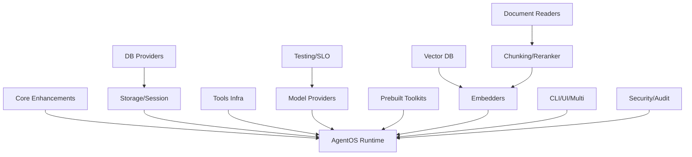

# AGXIOME — Master Task List

> Obiettivo: **raggiungere e superare Agno** in ogni categoria.
> Baseline: Agno ha ~400 .py file. AGXIOME ha 10 progetti .NET 10, 176 test, 0 errori.

---

## Legenda

| Sigla | Priorità | Criterio |
|-------|----------|----------|
| 🔴 P0 | **Critical** | Bloccante per feature parity — senza questo Agno è superiore |
| 🟡 P1 | **High** | Differenziale competitivo — miglioramento significativo |
| 🟢 P2 | **Medium** | Nice-to-have — completamento ecosistema |
| ⚪ P3 | **Low** | Ottimizzazione / polish |

---

## Riepilogo Quantitativo

| Dominio | Agno | Target AGXIOME | Supera Agno? |
|---------|------|----------------|--------------|
| **Model Provider** | ~35 | **50+** | ✅ Sì (+15) |
| **Prebuilt Toolkits** | ~120 | **150+** | ✅ Sì (+30) |
| **DB Provider** | 18 | **25+** | ✅ Sì (+7) |
| **Vector DB** | 20+ | **30+** | ✅ Sì (+10) |
| **Document Readers** | 18 | **25+** | ✅ Sì (+7) |
| **Embedders** | 18 | **25+** | ✅ Sì (+7) |
| **Chunking Strategies** | 7 | **12+** | ✅ Sì (+5) |
| **Reranker** | 4 | **8+** | ✅ Sì (+4) |
| **Total Test** | N/A | **500+** | ✅ Assoluto |

**Target complessivo: ~380 task, ~90-120 giorni di sviluppo.**

---

## Struttura dei File di Piano

| File | Contenuto |
|------|-----------|
| `PLAN/P01-MODEL_PROVIDERS.md` | 50+ provider LLM |
| `PLAN/P02-PREBUILT_TOOLKITS.md` | 150+ toolkit prebuilt |
| `PLAN/P03-DB_PROVIDERS.md` | 25+ database provider |
| `PLAN/P04-VECTOR_DB.md` | 30+ vector database |
| `PLAN/P05-DOCUMENT_READERS.md` | 25+ document readers |
| `PLAN/P06-EMBEDDERS.md` | 25+ embedder |
| `PLAN/P07-CHUNKING_RERANKERS.md` | 12+ chunker, 8+ reranker |
| `PLAN/P08-AGENTOS_RUNTIME.md` | Runtime server completo |
| `PLAN/P09-CORE_ENHANCEMENTS.md` | Migliorie core agent, team, workflow |
| `PLAN/P10-STORAGE_SESSION.md` | Session storage, cancellation, remote |
| `PLAN/P11-TOOLS_INFRA.md` | Infrastruttura tools (cache, limit, callable) |
| `PLAN/P12-CLI_UI_MULTI.md` | CLI, UI Control Plane, multi-framework |
| `PLAN/P13-SECURITY_AUDIT.md` | RBAC, audit, hardening |
| `PLAN/P14-TESTING_SLO.md` | Test plan esteso, benchmark, SLO |

---

## Dipendenze tra Piani

---

## Caricamento Lavoro per Fase

| Fase | Durata | Task | Focus |
|------|--------|------|-------|
| **Fase 1** (Core) | 30gg | P09, P10, P11 |背景执行, cancellation, remote agent, caching tools |
| **Fase 2** (Providers) | 25gg | P01, P03, P04 | 50 modelli, 25 DB, 30 vector DB |
| **Fase 3** (Content) | 20gg | P05, P06, P07 | 25 readers, 25 embedders, chunker, reranker |
| **Fase 4** (Toolkits) | 25gg | P02 | 150+ toolkit prebuilt |
| **Fase 5** (Runtime) | 20gg | P08, P12, P13 | AgentOS, CLI, UI, RBAC |
| **Fase 6** (Quality) | 10gg | P14 | Test, benchmark, SLO |

**Totale: ~130 giorni → ~6 mesi per un team di 2-3 dev.**
