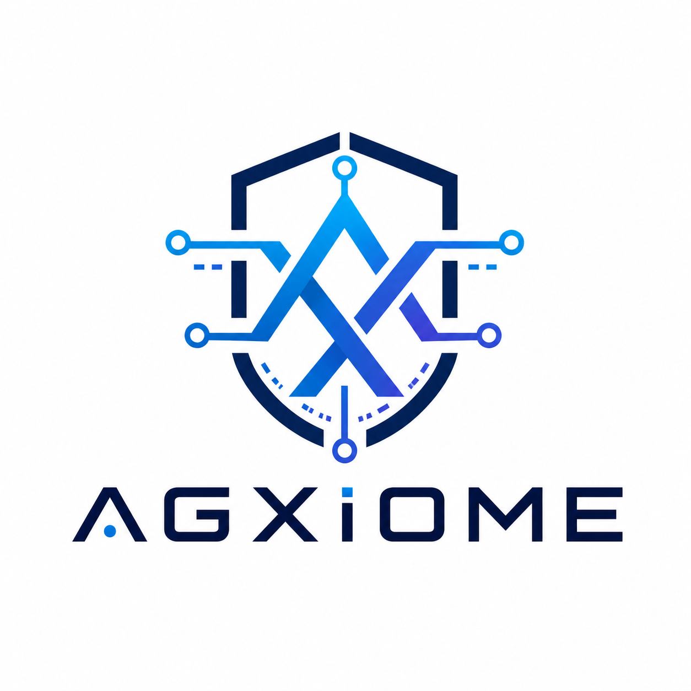

# AGXIOME Documentation

  

**Version 0.0.1-beta.1** · [agxiome.com](https://agxiome.com) · [GitHub](https://github.com/AGXIOME/AGXIOMA)

---

## What is AGXIOME?

AGXIOME is a **.NET 10 agentic AI orchestration framework** that lets you build, deploy, and scale AI agents, multi-agent teams, workflows, and RAG pipelines.

It provides a unified interface across **350+ providers** — 50 LLM backends, 25 databases, 30 vector stores, 25 embedders, 28 document readers, and 161 prebuilt toolkits — so you can swap infrastructure without changing application code.

---

## Table of Contents

### Getting Started
- [Quick Start](getting-started/quickstart.md) — Your first agent in 5 minutes
- [Installation](getting-started/installation.md) — NuGet packages and dependencies
- [Configuration](getting-started/configuration.md) — appsettings.json, environment variables, DI

### Core Concepts
- [Agent Lifecycle](core-concepts/agent-lifecycle.md) — Create → Configure → Run → Stream → Dispose
- [AgxiomeBuilder](core-concepts/agxiome-builder.md) — Fluent API for agent creation
- [Agent Request & Response](core-concepts/request-response.md) — Typed inputs and outputs
- [Memory & State](core-concepts/memory-state.md) — Conversation history and session state

### LLM Providers
- [Provider Overview](providers/overview.md) — 50+ LLM backends, unified interface
- [Cloud Providers](providers/cloud.md) — OpenAI, Anthropic, Gemini, DeepSeek, Groq, Mistral
- [Local Providers](providers/local.md) — Ollama, llama.cpp, LM Studio, GPT4All
- [Provider Factory](providers/factory.md) — Dynamic provider creation from config
- [Fallback Chains](providers/fallback.md) — Multi-provider resilience

### Teams & Swarms
- [Team Topologies](teams/topologies.md) — Router, Swarm, Pipeline, Supervisor
- [ForestSwarm](teams/forest-swarm.md) — Domain-based keyword routing
- [GrokSwarm](teams/grok-swarm.md) — Captain + Specialists decomposition
- [HeavySwarm](teams/heavy-swarm.md) — Parallel research with synthesis
- [Multi-Agent Teams](teams/multi-agent.md) — Role-based collaboration

### Tools & Functions
- [Tool System](tools/overview.md) — Register, discover, execute tools
- [AgxiomeFunction](tools/agxiome-function.md) — Typed functions with auto JSON Schema
- [Toolkits](tools/toolkits.md) — 161 prebuilt integrations
- [Custom Tools](tools/custom.md) — Build your own tool

### RAG & Knowledge
- [RAG Pipeline](rag/overview.md) — Retrieve-Augment-Generate
- [Document Ingestion](rag/ingestion.md) — PDF, DOCX, Markdown, HTML, EPUB
- [Chunking Strategies](rag/chunking.md) — Recursive, Semantic, SlidingWindow
- [Vector Search](rag/vector-search.md) — pgvector, Qdrant, Pinecone, 30+ backends
- [Culture System](rag/culture.md) — Shared organizational knowledge
- [Learning Machine](rag/learning.md) — Auto-learn user preferences

### Governance & Security
- [Guardrails](governance/guardrails.md) — Input/output validation, PII detection
- [Hooks](governance/hooks.md) — Lifecycle hooks (pre/post/tool)
- [HITL](governance/hitl.md) — Human-in-the-Loop approval
- [RBAC](governance/rbac.md) — Role-Based Access Control
- [Audit Trail](governance/audit.md) — Pseudonymized event logging
- [Cryptography](governance/crypto.md) — ECDSA, HMAC, key rotation

### Storage (CQRS)
- [CQRS Architecture](storage/cqrs.md) — Command/Query separation
- [Unit of Work](storage/uow.md) — Transactional boundaries
- [DB Providers](storage/db-providers.md) — PostgreSQL, SQLite, Redis, MongoDB, 25+ backends

### Workflows
- [Workflow Engine](workflows/overview.md) — DAG-based workflows
- [Steps & Transitions](workflows/steps.md) — Code steps, agent steps, conditions
- [Scheduler](workflows/scheduler.md) — Cron-based recurring execution

### Structured Output
- [Output Schemas](structured-output/overview.md) — Typed JSON responses
- [Parser & Response Model](structured-output/parser.md) — Deserialize and format

### XLink Transport
- [Protocol Overview](xlink/overview.md) — Checksum, compression, routing
- [Publish-Subscribe](xlink/pubsub.md) — Typed messaging between agents

### Realtime (SignalR)
- [SignalR Hubs](realtime/overview.md) — Agent, Log, Admin hubs
- [Backplane](realtime/backplane.md) — Redis scale-out
- [Reconnect & Replay](realtime/reconnect.md) — Resumable event streams

### Observability
- [Telemetry](observability/telemetry.md) — OpenTelemetry metrics
- [Logging](observability/logging.md) — Structured, pseudonymized

### Skills
- [Skill System](skills/overview.md) — Loadable agent capabilities
- [Skill Manager](skills/manager.md) — Registry, dependencies, binding
- [Remote Registry](skills/remote.md) — skills.sh integration

### Deployment
- [ASP.NET Core Host](deployment/aspnetcore.md) — Controllers, middleware, DI
- [Docker](deployment/docker.md) — Containerized deployment
- [NuGet Packages](deployment/nuget.md) — Package reference guide

### Reference
- [API Reference](reference/api.md) — Every public interface and type
- [Enum Catalog](reference/enums.md) — All 100+ enum types
- [Error Codes](reference/errors.md) — Structured error catalog
- [Configuration Schema](reference/config-schema.md) — Full appsettings.json reference

### Examples
- [Cookbook](../cookbook/README.md) — Ready-to-run code recipes
- [Demo Apps](../apps/) — 18 full demo applications
